# Soccer IQ Skill Tree

A dependency graph of soccer decision and positioning skills, from a 5-year-old in 3v3 up to pro concepts. Each node lists pause-and-decide scenarios that the game can simulate.

**How to read this file**

- A **node** is one decision skill. Its prerequisites are skills the child should handle first.
- **Bands** say where a skill is usually introduced. Kids can meet a skill earlier in the game than on the field.
- Each node maps to the standard **principles of play**. Attack: penetration, support, width, depth/mobility, improvisation. Defense: pressure (first defender), cover (second defender), balance, compactness, delay. Plus the two **transitions** (we lose the ball, we win the ball).
- Field directions in scenarios: "up" means toward the goal we attack. "Our goal" is the goal we defend. Blue = us, Red = them.

**Bands used**

| Band | Format | Typical age (US) |
|---|---|---|
| B0 | 3v3, no goalie | 4–6 (U5–U6) |
| B1 | 4v4, no goalie | 6–8 (U7–U8) |
| B2 | 7v7 with goalie | 8–10 (U9–U10) |
| B3 | 9v9 with goalie | 10–12 (U11–U12) |
| B4 | 11v11 | 12–14 (U13–U14) |
| B5 | Travel / high school | 14–18 |
| B6 | College / pro | 18+ |

---

## Contents

1. [The tree (Mermaid graph)](#the-tree)
2. [Start here: the first 8 nodes for this child](#start-here)
3. [Nodes](#nodes): foundations, attack on the ball, attack off the ball, defense, transitions, restarts, advanced team play
4. [Scanning: teaching a young kid to look up](#scanning)
5. [How federations sequence this by age](#federations)
6. [Notes for the game design](#game-design-notes)
7. [Sources](#sources)

---

## The tree

Each box label starts with the node's kebab-case id from the sections below. Mermaid's internal IDs use underscores and are sometimes shorter (`compact` is `squeeze-compact`).

```mermaid
flowchart TD
  classDef atk fill:#dbeafe,stroke:#1d4ed8,color:#111
  classDef def fill:#fee2e2,stroke:#b91c1c,color:#111
  classDef trn fill:#fef3c7,stroke:#b45309,color:#111
  classDef base fill:#e5e7eb,stroke:#374151,color:#111

  subgraph B0["B0 · 3v3 · age 4-6"]
    which_way["which-way<br/>Which goal is ours?"]
    look_up["look-up<br/>Eyes up while dribbling"]
    shoot_when_open["shoot-when-open"]
    dribble_to_space["dribble-to-space"]
    get_goal_side["get-goal-side<br/>Run home first"]
    one_goes["one-goes<br/>One bee goes"]
    kickoff_spread["kickoff-spread"]
  end

  subgraph B1["B1 · 4v4 · age 6-8"]
    see_the_trap["see-the-trap"]
    beat_or_keep["beat-or-keep (1v1)"]
    pass_to_open["pass-to-open"]
    forward_first["forward-first"]
    safe_back_pass["safe-back-pass"]
    shield_and_wait["shield-and-wait"]
    draw_and_pass["draw-and-pass (2v1)"]
    give_and_go["give-and-go"]
    get_open["get-open<br/>Find your island"]
    support_angle["support-angle"]
    width["stay-wide"]
    stay_high["stay-high"]
    support_behind["support-behind"]
    fill_the_spot["fill-the-spot"]
    shoulder_check["shoulder-check"]
    mark_the_free_one["mark-the-free-one"]
    cover["cover<br/>Be the backup"]
    delay["delay-dont-dive"]
    lost_it["lost-it-react"]
    won_it["won-it-go"]
    restart_spread["restart-spread"]
  end

  subgraph B2["B2 · 7v7 · age 8-10"]
    open_body["open-body"]
    run_in_behind["run-in-behind"]
    through_ball["through-ball"]
    check_away["check-away-check-to"]
    offside["offside-aware"]
    switch_play["switch-play"]
    risk_by_third["risk-by-third"]
    build_out["build-out"]
    show_outside["show-outside"]
    compact["squeeze-compact"]
    use_keeper["use-the-keeper"]
    counter_or_hold["counter-or-hold"]
  end

  subgraph B3["B3 · 9v9 · age 10-12"]
    third_man["third-man"]
    overlap["overlap-underlap"]
    decoy_run["decoy-run"]
    track_runner["track-the-runner"]
    press_triggers["press-triggers"]
    def_line["defensive-line"]
    counter_press["counter-press"]
  end

  subgraph B4["B4 · 11v11 · age 12-14"]
    between_lines["between-the-lines"]
    zonal["zonal-defending"]
    rest_defense["rest-defense"]
  end

  subgraph B5["B5 · Travel / HS"]
    positional_play["positional-play"]
    tempo["tempo-control"]
    block_height["block-height"]
  end

  subgraph B6["B6 · College / pro"]
    game_model["game-model & game management"]
  end

  which_way --> look_up
  which_way --> shoot_when_open
  which_way --> get_goal_side
  which_way --> kickoff_spread
  look_up --> dribble_to_space
  look_up --> shoot_when_open
  get_goal_side --> one_goes
  dribble_to_space --> see_the_trap
  dribble_to_space --> beat_or_keep
  look_up --> see_the_trap
  see_the_trap --> pass_to_open
  see_the_trap --> shield_and_wait
  pass_to_open --> forward_first
  pass_to_open --> safe_back_pass
  beat_or_keep --> draw_and_pass
  pass_to_open --> draw_and_pass
  draw_and_pass --> give_and_go
  which_way --> get_open
  get_open --> support_angle
  get_open --> width
  get_open --> stay_high
  get_open --> support_behind
  support_angle --> fill_the_spot
  width --> fill_the_spot
  look_up --> shoulder_check
  one_goes --> mark_the_free_one
  one_goes --> cover
  get_goal_side --> delay
  one_goes --> lost_it
  get_goal_side --> lost_it
  forward_first --> won_it
  look_up --> won_it
  kickoff_spread --> restart_spread
  get_open --> restart_spread

  shoulder_check --> open_body
  stay_high --> run_in_behind
  width --> run_in_behind
  run_in_behind --> offside
  forward_first --> through_ball
  run_in_behind --> through_ball
  support_angle --> check_away
  forward_first --> switch_play
  width --> switch_play
  forward_first --> risk_by_third
  safe_back_pass --> risk_by_third
  support_angle --> build_out
  safe_back_pass --> build_out
  delay --> show_outside
  cover --> compact
  mark_the_free_one --> compact
  safe_back_pass --> use_keeper
  won_it --> counter_or_hold
  lost_it --> counter_or_hold

  give_and_go --> third_man
  support_angle --> third_man
  width --> overlap
  give_and_go --> overlap
  check_away --> decoy_run
  run_in_behind --> decoy_run
  mark_the_free_one --> track_runner
  compact --> press_triggers
  show_outside --> press_triggers
  compact --> def_line
  offside --> def_line
  lost_it --> counter_press
  press_triggers --> counter_press

  open_body --> between_lines
  third_man --> between_lines
  def_line --> zonal
  track_runner --> zonal
  support_behind --> rest_defense
  counter_press --> rest_defense

  between_lines --> positional_play
  switch_play --> positional_play
  risk_by_third --> tempo
  counter_or_hold --> tempo
  zonal --> block_height
  press_triggers --> block_height

  positional_play --> game_model
  tempo --> game_model
  block_height --> game_model
  rest_defense --> game_model

  class look_up,which_way,shoulder_check,open_body base
  class shoot_when_open,dribble_to_space,see_the_trap,beat_or_keep,pass_to_open,forward_first,safe_back_pass,shield_and_wait,draw_and_pass,give_and_go,get_open,support_angle,width,stay_high,support_behind,fill_the_spot,run_in_behind,through_ball,check_away,offside,switch_play,risk_by_third,build_out,use_keeper,third_man,overlap,decoy_run,between_lines,positional_play,tempo,kickoff_spread,restart_spread atk
  class get_goal_side,one_goes,mark_the_free_one,cover,delay,show_outside,compact,track_runner,press_triggers,def_line,zonal,block_height def
  class lost_it,won_it,counter_or_hold,counter_press,rest_defense trn
```

**Node count: 54** (4 foundation, 30 attack, 12 defense, 5 transition, 2 restart, 1 capstone). By band: B0 7, B1 21, B2 12, B3 7, B4 3, B5 3, B6 1. Restart nodes are colored as attack in the graph. The capstone is uncolored.

---

## Start here: the first 8 nodes for this child

The order alternates attack and defense so each session has variety. Each step targets a problem the parent sees.

| # | Node | Problem it fixes | Kid phrase |
|---|---|---|---|
| 1 | [`look-up`](#look-up) | Doesn't look up | "Eyes up! Where are your friends?" |
| 2 | [`get-goal-side`](#get-goal-side) | Team swarms the ball | "Run home first." |
| 3 | [`dribble-to-space`](#dribble-to-space) | Runs into crowds | "Dribble to the empty grass." |
| 4 | [`one-goes`](#one-goes) | Team swarms the ball | "Only one bee chases the ball." |
| 5 | [`see-the-trap`](#see-the-trap) | Fast dribble ends in a trap of defenders | "Two red shirts coming? Time to let it go." |
| 6 | [`mark-the-free-one`](#mark-the-free-one) | Opponents pass to the open player | "Guard the kid nobody is guarding." |
| 7 | [`pass-to-open`](#pass-to-open) | Blind passes get stolen | "Pass to a friend with no red shirt near." |
| 8 | [`forward-first`](#forward-first) (with [`safe-back-pass`](#safe-back-pass)) | Turns and passes back toward own goal without looking | "Look up the field first. Never pass across our goal." |

**Why this order**

- `look-up` comes first because every other decision depends on seeing the field.
- `dribble-to-space` comes before `see-the-trap`. His speed is a strength, so the game should first reward good dribbling and then teach when to stop. The FA says foundation-age players should be encouraged to take people on, so do not teach him that dribbling is wrong.
- `see-the-trap` comes before `pass-to-open`. The useful trigger for a 5-year-old is "I see two defenders," not "pass when stuck." The current "pass when stuck" cue gives him a trigger but no target, so he passes to wherever his body faces.
- `forward-first` comes last. It needs `pass-to-open`, and it fixes the blind back pass by giving him an order to look in: up the field, then sideways, then back.

**Honest expectation:** coaching sources agree that 5- and 6-year-olds swarm as a normal stage of development (see [federations](#federations)). The game can teach him the idea early. His teammates will still swarm, so he may be the only one in the right spot, and that is fine. Praise the correct choice even when the play fails because a teammate was not there.

**After the first 8:** `get-open`, `support-angle`, `cover`, `lost-it-react`, `won-it-go`, `shield-and-wait`, `draw-and-pass`, `shoulder-check`. These are the core of 4v4.

---

## Nodes

Scenario format: **Setup** → **Choices** → **Best** (and why) → **Bad outcome** (what to animate when the child picks wrong).

### Foundations

#### `which-way`: Know which goal is ours

- **Kid name:** "Which goal do we score in?"
- **Phase:** all · **Band:** B0 (3v3, age 4–6)
- **Principle:** Orientation. It is the base for every principle, because "forward" and "home" depend on it.
- **Prerequisites:** none
- **Cue:** Our goal is behind us. Their goal is the one we kick toward. Teams switch ends at halftime.
- **Scenarios:**
  1. **Setup:** Blue kid has the ball in the middle. No defenders are near. **Choices:** dribble up / dribble back. **Best:** up, toward their goal. **Bad outcome:** he dribbles to his own goal and Red steals it there.
  2. **Setup:** Second half, same field, the sides have switched. **Choices:** tap the goal we attack. **Best:** the other goal from the first half. **Why:** teams switch ends. **Bad outcome:** he scores an own goal.
- **Drill:** "Home and Away." Put a towel at one end ("home") and a bucket at the other ("away"). Call "Home!" or "Away!" and he dribbles to the right end. Swap ends at "halftime."

#### `look-up`: Eyes up while dribbling

- **Kid name:** "Eyes up! Where are your friends?"
- **Phase:** all · **Band:** B0
- **Principle:** Perception. It is the base for penetration and support, because you cannot choose what you cannot see.
- **Prerequisites:** `which-way`
- **Technique needed:** dribbling with small touches so the ball stays close. A child who kicks the ball far ahead must stare at it.
- **Cue:** Between touches, glance up and find three things: the goal, the nearest friend, the nearest red shirt.
- **Scenarios:**
  1. **Setup:** Blue kid dribbles. The camera starts zoomed on the ball. **Choices:** "Keep looking at the ball" / "Look up" (button). **Best:** look up. **Why:** the view zooms out and shows an open friend and a defender running in. **Bad outcome:** with eyes down, he runs straight into a defender he never saw.
  2. **Setup:** Freeze mid-dribble, then hide the screen for one second. **Question:** "Where was your friend?" **Choices:** tap left / middle / right. **Best:** where the friend was. **Why:** this trains the habit of taking a mental picture.
  3. **Setup:** Two Red defenders. One is near, one is far. **Question:** "Which red shirt can reach you first?" **Best:** the near one. **Bad outcome:** he dribbles toward the near one.
- **Drill:** "Fingers." He dribbles while you hold up 1–5 fingers. He shouts the number. Later, hold up a color card, and he dribbles to the cone of that color.

#### `shoulder-check`: Look before the ball arrives

- **Kid name:** "Peek behind you before the ball comes."
- **Phase:** attack (also defense) · **Band:** B1 (4v4, age 6–8). The idea can be shown earlier in the game.
- **Principle:** Perception before receiving (scanning). It feeds penetration (turn and go forward) and support (know your next pass).
- **Prerequisites:** `look-up`
- **Cue:** Your friend is about to pass to you. Before the ball comes, look over one shoulder, then the other. Is a red shirt behind you?
- **Scenarios:**
  1. **Setup:** A Blue friend is about to pass to him. He faces his own goal. A Red defender is directly behind him. **Choices:** "Turn with the ball" / "Pass it back to your friend" / "Peek first." **Best:** peek first, which shows the defender, then pass back or shield. **Why:** turning into a defender loses the ball. **Bad outcome:** he turns blind and the defender takes it.
  2. **Setup:** Same setup, but no one is behind him. **Choices:** same. **Best:** peek, then turn and go. **Why:** the peek shows open grass, so turning is safe and fast.
  3. **Setup:** The ball is rolling to him. The game asks: "Did you peek?" **Choices:** "Yes, red behind me" / "Yes, nobody behind me." This is a quiz based on a short preview shown 2 seconds earlier.
- **Drill:** "Behind-the-back card." You stand behind him and hold up a color or a number. A second person (or you, after you run around) passes him the ball. He must name what he saw before he touches it. Start with no pressure.

#### `open-body`: Receive half-turned

- **Kid name:** "Stand sideways so you can see both ways."
- **Phase:** attack · **Band:** B2 (7v7, age 8–10)
- **Principle:** Support and penetration. An open body lets you see forward and back, so you can play forward faster.
- **Prerequisites:** `shoulder-check`
- **Technique needed:** receiving across the body with the back foot (the foot farther from the passer).
- **Cue:** Hips point between the passer and the goal you attack, not straight at the passer.
- **Scenarios:**
  1. **Setup:** He is wide on the side. The passer is in the middle behind him. A defender is 6 yards away. **Choices:** face the passer / stand sideways. **Best:** sideways. **Why:** he can take the ball forward in one touch. **Bad outcome:** facing the passer, he must take two extra touches to turn, and the defender closes.
  2. **Setup:** A defender is tight behind him. **Choices:** open up / stay closed with his back to the defender. **Best:** stay closed and shield. **Why:** opening up with a tight defender exposes the ball. The cue is defender distance.
- **Drill:** Pass to him from the side. Put a cone gate ahead of him. He must receive with the far foot and dribble through the gate in two touches.

### Attack: on the ball

#### `shoot-when-open`: Shoot when you can

- **Kid name:** "Close to the goal and nobody in front? Shoot!"
- **Phase:** attack · **Band:** B0
- **Principle:** Penetration (shooting).
- **Prerequisites:** `which-way`, `look-up`
- **Technique needed:** a shot with the inside of the foot or the laces.
- **Cue:** I am close to the goal, and there is a clear line from the ball to the goal.
- **Scenarios:**
  1. **Setup:** He is 5 yards out. The goal is open. A defender is chasing from behind. **Choices:** shoot / dribble closer / pass. **Best:** shoot now. **Why:** the defender catches up if he waits. **Bad outcome:** an extra touch, and the defender pokes it away.
  2. **Setup:** He is 5 yards out. A defender stands in the shooting line. A teammate is open on the other side of the goal. **Choices:** shoot / pass across / dribble around. **Best:** pass across, or dribble one step to clear the line. **Why:** the shot hits the defender. **Bad outcome:** a blocked shot, and Red counters.
  3. **Setup:** He is far away, at midfield. The goal is open, but it is very far. **Choices:** shoot / dribble closer. **Best:** dribble closer. **Why:** a long shot is weak and easy to stop. **Bad outcome:** the ball rolls slowly and a Red player collects it.
- **Drill:** "Shoot or go." Put 2 cones as a goal. You stand in different spots. If the line is open, he shoots. If you are blocking it, he must move the ball one step first.

#### `dribble-to-space`: Dribble into empty grass

- **Kid name:** "Dribble to the empty grass, away from the crowd."
- **Phase:** attack · **Band:** B0
- **Principle:** Penetration (dribbling) and improvisation.
- **Prerequisites:** `look-up`
- **Technique needed:** changes of direction (inside and outside of the foot, a pull-back).
- **Cue:** Where is the biggest empty patch between me and their goal?
- **Scenarios:**
  1. **Setup:** He has the ball in the middle. Two Red players are straight ahead. The right side is empty. **Choices:** dribble straight / dribble right / stop. **Best:** dribble right, then up. **Why:** empty grass lets his speed work. **Bad outcome:** straight ahead, he runs into two defenders.
  2. **Setup:** One defender is ahead. There is open grass behind the defender and on both sides. **Choices:** go left of the defender / right / straight at. **Best:** go to the side away from the defender's strong foot, or the bigger space. **Why:** speed into space beats one defender.
  3. **Setup:** All players are on the left side in a crowd. He wins the ball at the edge of the crowd. **Choices:** dribble back into the crowd / dribble out to the right. **Best:** out to the right. **Why:** crowds steal the ball, and open grass gives time.
- **Drill:** "Island hop." Scatter 4–5 hula hoops or towels ("islands"). You walk around as the "shark." He dribbles to whichever island is farthest from you. Switch islands every few seconds.

#### `beat-or-keep`: Take on one defender

- **Kid name:** "One defender? Try to beat them!"
- **Phase:** attack · **Band:** B1 (start in B0)
- **Principle:** Penetration and improvisation (1v1).
- **Prerequisites:** `dribble-to-space`
- **Technique needed:** one move (a step-over, a cut, or a change of pace).
- **Cue:** Only one defender is between me and the goal, and no second defender is close behind.
- **Scenarios:**
  1. **Setup:** 1v1 near their goal. No other Red players are near. **Choices:** take on / pass back / stop. **Best:** take on. **Why:** beating one defender here is a goal chance. **Bad outcome (for passing back):** the chance is gone.
  2. **Setup:** 1v1, but a second Red is 3 yards behind the first. **Choices:** take on / pass. **Best:** pass or turn away. **Why:** after he beats the first defender, the second one is waiting. This links to `see-the-trap`.
  3. **Setup:** 1v1, and the defender is running at him fast. **Choices:** cut sharply / keep straight. **Best:** cut. **Why:** a defender who runs in fast is easy to beat with a change of direction.
- **Drill:** Parent vs. kid 1v1 to a cone goal. Walk at first, then jog. Reward any move he tries.

#### `see-the-trap`: Notice when you are getting trapped

- **Kid name:** "Two red shirts coming? Time to let it go."
- **Phase:** attack · **Band:** B1. Start this now for this child.
- **Principle:** Penetration vs. possession. It is the decision point between dribbling and passing.
- **Prerequisites:** `dribble-to-space`, `look-up`
- **Cue:** Count red shirts within a few steps. One is OK. Two or more means a trap is closing. Also: are my friends far behind me?
- **Scenarios:**
  1. **Setup:** He sprints up the right side and is 10 yards ahead of all teammates. Two Red players close from the front and the inside. **Choices:** keep dribbling / stop and shield / pass back to a friend. **Best:** stop and shield (or slow down), then pass when a friend arrives. **Why:** two defenders win the ball, and his friends are too far to help. **Bad outcome:** he keeps going and gets squeezed against the sideline.
  2. **Setup:** He beats one defender. A second comes from the side. A friend is open in the middle. **Choices:** dribble at the second defender / pass to the friend. **Best:** pass. **Why:** he has pulled two defenders to him, so his friend is free.
  3. **Setup:** Same sprint, but only one defender is near, and he is in front. **Choices:** keep going / pass. **Best:** keep going. **Why:** it is not a trap yet. The game should teach that dribbling is fine until the trap appears.
  4. **Setup:** Red defenders are on both sides, but there is a gap between them. **Choices:** split the gap / turn back. **Best:** turn back if the gap is closing. Split the gap only if it is wide. This is an advanced variant.
- **Drill:** "Two cone trap." He dribbles toward two parents (or one parent plus a chair). When the second "defender" steps in, he must stop the ball under his foot and look for a target cone to pass to.

#### `shield-and-wait`: Protect the ball until help comes

- **Kid name:** "Hide the ball with your body and wait for a friend."
- **Phase:** attack · **Band:** B1
- **Principle:** Support (buy time for support to arrive) and possession.
- **Prerequisites:** `see-the-trap`
- **Technique needed:** shielding, with the body between the ball and the defender and the ball on the far foot.
- **Cue:** No friend is close enough to pass to yet, and a defender is right on me.
- **Scenarios:**
  1. **Setup:** He is trapped by one defender near the sideline. A teammate is running toward him and is 2 seconds away. **Choices:** blind pass / dribble at the defender / shield. **Best:** shield, then pass when the friend arrives. **Bad outcome (blind pass):** a Red player intercepts.
  2. **Setup:** He is facing his own goal with a defender behind him. **Choices:** turn / shield and pass back to a friend who is open. **Best:** shield, then pass to the friend. **Why:** turning into pressure loses the ball.
- **Drill:** "Keep it 5 seconds." He shields the ball in a small square while you try to touch it. Count to 5. Then you call "Pass!" and he plays to a cone.

#### `pass-to-open`: Pass to a teammate who is open

- **Kid name:** "Pass to a friend with no red shirt near them."
- **Phase:** attack · **Band:** B1
- **Principle:** Support and possession.
- **Prerequisites:** `see-the-trap`, `look-up`
- **Technique needed:** a short pass with the inside of the foot, about 5–10 yards.
- **Cue:** Look at the friend, then at the space around the friend. Is a red shirt close to them or standing between us?
- **Scenarios:**
  1. **Setup:** He has the ball under pressure. Friend A is open to the side. Friend B is ahead, but a Red defender is next to B. **Choices:** pass to A / pass to B / keep dribbling. **Best:** A. **Why:** B is marked. **Bad outcome:** the pass to B is stolen.
  2. **Setup:** A friend is open, but a Red defender stands in the line between them. **Choices:** pass now / move one step and pass / dribble. **Best:** move one step so the line is clear, then pass. **Why:** a pass through a defender is a gift to Red.
  3. **Setup:** Both friends are marked. **Choices:** pass to one / shield / dribble to space. **Best:** shield or dribble to space. **Why:** no good pass exists, so keep the ball.
- **Drill:** "Open gate." Set up 2 small cone gates as "friends." Stand near one gate as the defender. He must pass through the gate you are not guarding. Switch gates without warning.

#### `forward-first`: Look up the field first

- **Kid name:** "Look forward first, then sideways, then back."
- **Phase:** attack · **Band:** B1. US Soccer material lists this as a team game plan at 9v9.
- **Principle:** Penetration first, then possession.
- **Prerequisites:** `pass-to-open`
- **Cue:** Check options in order: the goal, a friend ahead, a friend beside, a friend behind.
- **Scenarios:**
  1. **Setup:** He is stuck with a defender in front. Friend A is open ahead and to the side. Friend B is behind him, near his own goal. **Choices:** A / B. **Best:** A. **Why:** a forward pass gets closer to scoring. **Bad outcome (B, blind):** the pass rolls toward his own goal and a Red forward steals it next to the goal.
  2. **Setup:** No forward option. A friend is open to the side. **Choices:** sideways pass / backward pass / force forward. **Best:** sideways. **Why:** it keeps the ball and keeps it away from our goal.
  3. **Setup:** No forward or side option. A friend is open behind him, away from the middle of our goal, with no Red player near. **Choices:** pass back / force a dribble. **Best:** pass back. **Why:** a safe back pass keeps the ball. Compare with `safe-back-pass`.
  4. **Setup:** A friend is ahead but marked. A friend is behind and wide open. **Choices:** forward / back. **Best:** back. **Why:** "forward first" means "look forward first," not "always pass forward."
- **Drill:** "Three cones." Put a cone ahead, one to the side, and one behind. You stand near one or two of them as the "defender." He must check all three in order and pass to the first open cone.

#### `safe-back-pass`: When a back pass is right

- **Kid name:** "Pass back only to a friend who is open, and never across our goal."
- **Phase:** attack · **Band:** B1
- **Principle:** Possession and safety (security near our goal).
- **Prerequisites:** `pass-to-open`
- **Cue:** Before passing back, find the friend first. Is there a red shirt near them? Is the pass going across the front of our goal?
- **Scenarios:**
  1. **Setup:** He is near his own goal, facing it, with a defender behind. A friend is wide near the sideline. The middle in front of our goal has a Red forward. **Choices:** pass to the middle / pass to the wide friend / kick it out of bounds. **Best:** the wide friend if open. Otherwise kick it out. **Why:** a steal in front of our goal is a goal for Red. **Bad outcome:** the Red forward intercepts in the middle and scores.
  2. **Setup:** He turns to pass back. No friend is behind him (all teammates are ahead). **Choices:** pass back anyway / dribble sideways / shield. **Best:** shield or dribble sideways. **Why:** a back pass to nobody is a pass to Red. This is the exact mistake the parent sees.
  3. **Setup:** He is in the attacking half and stuck. A friend behind is open, and no Red is near. **Choices:** pass back / force a dribble. **Best:** pass back. **Why:** far from our goal, a back pass is low risk and lets the team try again.
- **Drill:** "Danger zone." Mark a zone in front of a small goal with a rope or chalk. Play passing games where any pass that goes through the zone gives you (the defender) a free shot.

#### `draw-and-pass`: The 2v1

- **Kid name:** "Make the defender come to you, then pass."
- **Phase:** attack · **Band:** B1
- **Principle:** Penetration and support (create and use a numbers advantage).
- **Prerequisites:** `beat-or-keep`, `pass-to-open`
- **Cue:** Watch the defender's feet. When the defender steps toward me, my friend is free. If the defender stays with my friend, I keep going.
- **Scenarios:**
  1. **Setup:** He and a friend vs. one defender, attacking the goal. The defender stands between them. **Choices:** dribble at the defender / pass right away / dribble at the defender, then pass when the defender commits. **Best:** the third choice. **Why:** an early pass lets the defender shift to the friend. **Bad outcome (pass early):** the defender intercepts or catches the friend.
  2. **Setup:** Same, but the defender drops toward the friend. **Choices:** pass / dribble to goal. **Best:** dribble to goal. **Why:** the defender chose the friend, so the path to goal is open.
  3. **Setup:** He waits too long, and the defender is already on him. **Choices:** pass now / try to beat. **Best:** pass now. It is late but still open.
- **Drill:** 2v1 with a sibling or friend against a parent. Use a wide grid. Reward goals that come from a pass after the parent commits.

#### `give-and-go`: Wall pass

- **Kid name:** "Pass and run, get it back."
- **Phase:** attack · **Band:** B1–B2
- **Principle:** Penetration, support, and mobility.
- **Prerequisites:** `draw-and-pass`
- **Technique needed:** passing on the run and a one-touch return pass (for the partner).
- **Cue:** A defender is in front of me, and a friend is beside me. Pass to the friend and run past the defender.
- **Scenarios:**
  1. **Setup:** A defender is in front. A friend is to the side, 5 yards away. Space is behind the defender. **Choices:** dribble / pass and stand / pass and run behind the defender. **Best:** pass and run. **Why:** the defender watches the ball and loses you. **Bad outcome (pass and stand):** the friend has no return pass.
  2. **Setup:** He passed and ran, but the defender followed him. **Choices (for the friend):** return the pass / turn and go. **Best:** turn and go. **Why:** the defender left the friend's space.
- **Drill:** Use a garage wall as the "friend." He passes against the wall at an angle, runs around a cone ("defender"), and collects the rebound.

### Attack: off the ball (getting open)

#### `get-open`: Find your own island

- **Kid name:** "Find your own island where a friend can pass to you."
- **Phase:** attack · **Band:** B1 (show in B0)
- **Principle:** Support and mobility.
- **Prerequisites:** `which-way`
- **Cue:** Where is a spot with no red shirt near it and a clear line from the ball to me?
- **Scenarios:**
  1. **Setup:** A friend has the ball and is getting pressured. He is standing right next to the friend. **Choices:** stay next to the friend / move 5–8 yards away to open grass / run to the ball. **Best:** move away to open grass. **Why:** standing next to the ball brings his defender with him, so there is no room for the pass. **Bad outcome (run to the ball):** three Blue and three Red players are all on the ball, and Red pokes it out to an open Red player.
  2. **Setup:** He is open, but a Red player stands in the line between him and the ball. **Choices:** stay / slide two steps left. **Best:** slide. **Why:** the line must be clear.
  3. **Setup:** Two open spots: one ahead, one behind. **Choices:** ahead / behind. **Best:** ahead if it is safe. Behind is fine if the friend is under heavy pressure. This links to `support-angle`.
- **Drill:** "Find me." You dribble slowly. He must stand where you can pass to him, and you count "1-2-3" before passing. Put a chair or cone between you as a "defender." He must move so the chair is not in the line.

#### `support-angle`: Show at an angle

- **Kid name:** "Make a triangle with the ball."
- **Phase:** attack · **Band:** B1
- **Principle:** Support (angle and distance).
- **Prerequisites:** `get-open`
- **Cue:** I should not be directly behind the defender (blocked), and not right next to the ball (crowded). I should be diagonal and a few steps away.
- **Scenarios:**
  1. **Setup:** A friend has the ball. A defender is in front of the friend. He is directly behind the defender. **Choices:** stay / move to the side. **Best:** to the side. **Why:** from behind the defender, any pass is blocked.
  2. **Setup:** In 3v3, the forward has the ball near the sideline. Both backs are on the same flat line. **Choices (for one back):** stay level / move diagonal behind. **Best:** diagonal. **Why:** it makes a triangle, so there are two passing lines.
  3. **Setup:** A friend is under heavy pressure. **Choices:** come close (3 yards) / stay far (15 yards). **Best:** a bit closer. **Why:** under pressure, the friend can only make a short pass.
- **Drill:** "Triangle tag." Parent and kid pass with a cone as a "defender" in the middle. After each pass, the kid moves so the cone is not between them.

#### `stay-wide` (width): Stay near the sideline when we have the ball

- **Kid name:** "When we have the ball, go to the side, near the line."
- **Phase:** attack · **Band:** B1
- **Principle:** Width.
- **Prerequisites:** `get-open`
- **Cue:** When we have the ball, the field gets big. When they have the ball, it gets small.
- **Scenarios:**
  1. **Setup:** In 4v4, Blue has the ball in the middle. Both wide Blue players are in the middle too. **Choices (for one):** stay / run wide. **Best:** run wide. **Why:** it pulls a defender wide and opens the middle. **Bad outcome:** everyone in the middle, Red squeezes, and the ball is lost.
  2. **Setup:** He is wide and open, and a pass comes to him. **Choices:** dribble inside / dribble up the line / pass inside. **Best:** depends on the defender. This leads into `dribble-to-space`.
- **Drill:** Use cones to make two side "lanes." In a 2v1 with a parent, one rule: when we have the ball, one player must be in a lane.

#### `stay-high` (depth forward): Be the far point

- **Kid name:** "Be the top of the triangle, close to their goal."
- **Phase:** attack · **Band:** B1. In 3v3, this is the forward's job.
- **Principle:** Depth (stretch the field forward) and penetration (a forward target).
- **Prerequisites:** `get-open`
- **Cue:** I am the player nearest their goal. I stay ahead of the ball so my team has a forward pass.
- **Scenarios:**
  1. **Setup:** In 3v3 he is the forward. Blue wins the ball near its own goal. **Choices:** run back to help / stay up the field and get open. **Best:** stay up and open. **Why:** it gives a forward pass and stretches Red. **Bad outcome (runs back):** five players crowd near our goal and Red wins it back.
  2. **Setup:** He is the forward. A Red defender is right next to him. **Choices:** stand still / move away to open grass and stay high. **Best:** move away. This combines `stay-high` and `get-open`.
- **Drill:** "Target." Mark a far zone. A sibling or parent passes from the "back." He must be in the far zone and open when the pass is made.

#### `support-behind`: Be the safe pass

- **Kid name:** "Be the helper behind the ball."
- **Phase:** attack (with defensive value) · **Band:** B1
- **Principle:** Support (depth from behind) and balance.
- **Prerequisites:** `get-open`
- **Cue:** Is anyone behind the ball? If not, I go there.
- **Scenarios:**
  1. **Setup:** In 3v3, both Blue backs have pushed up with the ball. No one is behind. **Choices (for one back):** keep going / drop behind. **Best:** drop behind. **Why:** if Blue loses the ball, Red has an empty field to our goal. **Bad outcome:** a Red counter and an easy goal.
  2. **Setup:** The forward is stuck and faces our goal. **Choices (for the back):** come under at an angle / stay far. **Best:** come under at an angle. **Why:** it gives the forward a safe pass.
- **Drill:** Use a rope behind the play as a "safety line." In a 2v1, one player must stay behind the ball at all times.

#### `fill-the-spot`: Fill an empty spot

- **Kid name:** "A friend left their spot? Fill it!"
- **Phase:** attack and defense · **Band:** B1–B2. The US Soccer 4v4 guidance names this directly.
- **Principle:** Mobility and balance (keep shape while players rotate).
- **Prerequisites:** `support-angle`, `stay-wide`
- **Cue:** Look at our shape. Is a corner of our triangle or diamond empty?
- **Scenarios:**
  1. **Setup:** In 4v4 diamond shape, the back player dribbles forward into midfield. **Choices (for a wide player):** stay wide / drop into the back spot. **Best:** drop into the back spot. **Why:** someone must give support from behind.
  2. **Setup:** The right-side player runs inside. **Choices (for the forward):** stay / drift to the right. **Best:** drift right so the right side is not empty.
- **Drill:** Put 3–4 cones in a diamond. When the parent moves the ball and stands on one cone, the child must stand on a different cone to keep the shape.

#### `run-in-behind`: Run into the space behind defenders

- **Kid name:** "Run to the empty grass behind their players."
- **Phase:** attack · **Band:** B2 (7v7)
- **Principle:** Penetration (without the ball) and depth.
- **Prerequisites:** `stay-high`, `stay-wide`
- **Cue:** The defender faces the ball, not me. There is open grass behind the defender. My friend can see me.
- **Scenarios:**
  1. **Setup:** A friend has the ball at midfield with time. A Red defender is ball-watching. Space is behind the defender. **Choices:** come short / run behind. **Best:** run behind. **Why:** a pass in behind means 1v1 with the keeper.
  2. **Setup:** A friend has the ball but is under pressure and cannot look up. **Choices:** run behind / come short. **Best:** come short. **Why:** the friend cannot make a long pass now.
  3. **Setup:** He runs too early and is past the last defender before the pass. **Outcome:** offside. This links to `offside-aware`.
- **Drill:** A parent holds the ball. He jogs alongside a "defender" cone line. When the parent's head comes up, he sprints behind the line and receives a rolled pass.

#### `check-away-check-to`: Move away to come back open

- **Kid name:** "Fake away, then come back for the ball."
- **Phase:** attack · **Band:** B2
- **Principle:** Mobility.
- **Prerequisites:** `support-angle`
- **Cue:** The defender is tight. Take them one way, then cut back to the other.
- **Scenarios:**
  1. **Setup:** A Red defender stands right next to him. A friend is ready to pass. **Choices:** stand still and call / jog 3 steps away then sprint back toward the ball. **Best:** away then back. **Why:** this creates a gap to receive in. **Bad outcome (stand still):** the defender steps in front and intercepts.
  2. **Setup:** The defender follows him short. Space opens behind. **Choices:** keep coming short / spin and run behind. **Best:** spin. This links to `run-in-behind`.
- **Drill:** A parent shadows him as the defender. He must lose the parent for one second before calling for the ball.

#### `offside-aware`: Stay onside

- **Kid name:** "Don't be past their last player before the pass."
- **Phase:** attack · **Band:** B2. US Soccer applies offside from U9 at 7v7.
- **Principle:** Depth, timed with the law.
- **Prerequisites:** `run-in-behind`
- **Cue:** Where is the second-last Red player (usually the last defender)? Stay level with them until the pass leaves my friend's foot.
- **Scenarios:**
  1. **Setup:** He is 2 yards past the last defender. A friend is about to pass. **Choices:** stay / step back level. **Best:** step back. **Why:** the goal would not count.
  2. **Setup:** He is level, and the pass is played. **Choices:** run now / wait. **Best:** run now.
- **Drill:** A rope on the ground is the "defender line." The parent says "pass" at random times. He must be behind the rope when "pass" is called, then sprint.

#### `through-ball`: Pass into space ahead of a runner

- **Kid name:** "Pass to where your friend is going, not where they are."
- **Phase:** attack · **Band:** B2
- **Principle:** Penetration (passing).
- **Prerequisites:** `forward-first`, `run-in-behind`
- **Technique needed:** a weighted pass with the right pace.
- **Cue:** Is my friend running? Is the space ahead of them empty?
- **Scenarios:**
  1. **Setup:** A friend sprints behind the Red defenders. **Choices:** pass to the friend's feet / pass into the space ahead / hold. **Best:** space ahead. **Why:** a pass to the feet makes them stop. **Bad outcome:** the defender recovers.
  2. **Setup:** The keeper is off the line, close to the space. **Choices:** through ball / pass to feet / hold. **Best:** pass to feet or hold. **Why:** the keeper will collect a through ball.
- **Drill:** He passes to a cone 5 yards ahead of a moving partner. The partner must collect it without breaking stride.

#### `switch-play`: Change the side of attack

- **Kid name:** "Too crowded here? Send it to the other side!"
- **Phase:** attack · **Band:** B2–B3
- **Principle:** Width and penetration (change the point of attack).
- **Prerequisites:** `forward-first`, `stay-wide`
- **Technique needed:** a longer pass, or two quick passes across.
- **Cue:** Count players on each side. If our side is crowded and the other side is empty, switch.
- **Scenarios:**
  1. **Setup:** In 7v7, Blue is on the left. Five Red players have shifted left. The Blue right-side player is alone on the right. **Choices:** keep going left / switch through the middle / long ball right. **Best:** switch through the middle (two passes), or long ball if he can kick it. **Bad outcome (keep going left):** squeezed and lost.
  2. **Setup:** The switch is on, but a Red midfielder is in the passing lane. **Choices:** long pass / pass back to a center-back first. **Best:** back to the center-back, then switch. **Why:** it goes around the block.
- **Drill:** Use a wide grid with two end zones. A point counts double after the ball has gone through both side lanes.

#### `risk-by-third`: Take risks near their goal, play safe near ours

- **Kid name:** "Near our goal, be safe. Near their goal, be brave."
- **Phase:** attack · **Band:** B2
- **Principle:** Safety vs. risk across thirds of the field. It is an 11v11 coaching theme in US Soccer material that is introduced earlier.
- **Prerequisites:** `forward-first`, `safe-back-pass`
- **Cue:** Which third of the field am I in?
- **Scenarios:**
  1. **Setup:** He has the ball in his own third with a defender close. **Choices:** dribble past / pass safe / clear it. **Best:** pass safe, or clear if no pass exists. **Why:** losing it here is a goal for Red.
  2. **Setup:** The same 1v1 in the attacking third. **Choices:** dribble past / pass back. **Best:** dribble past. **Why:** losing it here costs little, and winning it is a goal chance.
- **Drill:** Color the field into 3 zones with cones. In the parent vs. kid game, losing the ball in the "red" zone gives the parent a penalty kick. Losing it in the "green" zone costs nothing.

#### `build-out`: Play out from the back

- **Kid name:** "Start from the back with short passes."
- **Phase:** attack · **Band:** B2. The US 7v7 format uses a build-out line to encourage it.
- **Principle:** Support, width, and possession.
- **Prerequisites:** `support-angle`, `safe-back-pass`
- **Cue:** Defenders spread wide. A midfielder shows in the middle. Find the open player.
- **Scenarios:**
  1. **Setup:** Blue goal kick. Red retreats behind the build-out line. Two Blue defenders are still in the middle near the keeper. **Choices (for defenders):** stay / split wide. **Best:** split wide. **Why:** it gives the keeper two easy passes.
  2. **Setup:** A Red forward presses one defender. The other defender is free. **Choices (keeper):** pass to the pressed defender / the free defender / kick long. **Best:** the free defender.
  3. **Setup:** All options are marked. **Choices:** force the short pass / kick long. **Best:** kick long. **Why:** security first.
- **Drill:** 3v1 or 3v2 keep-away starting from the keeper. Score by dribbling over midfield.

#### `use-the-keeper`: Pass back to the goalkeeper

- **Kid name:** "The keeper is your friend too."
- **Phase:** attack · **Band:** B2
- **Principle:** Support (depth from behind) and safety.
- **Prerequisites:** `safe-back-pass`
- **Cue:** I am under pressure near our goal. The keeper is open and off to the side of the goal.
- **Scenarios:**
  1. **Setup:** A defender is pressed near our box. The keeper is to the side. **Choices:** pass to the keeper wide / pass across the box / kick it out. **Best:** keeper wide. **Why:** a missed pass wide of the goal is not a goal.
  2. **Setup:** A Red forward is standing between him and the keeper. **Choices:** pass to the keeper / kick out. **Best:** kick out.
- **Drill:** Keeper (parent) and defender (kid) pass. A "forward" cone moves around. He must pass only when the line is clear and the angle is wide of the goal.

#### `third-man`: The third-player run

- **Kid name:** "Pass to a friend so they can pass to a third friend who is running."
- **Phase:** attack · **Band:** B3 (9v9)
- **Principle:** Penetration, support, and mobility. It is a core idea in Barcelona-style positional play.
- **Prerequisites:** `give-and-go`, `support-angle`
- **Cue:** A direct pass to the runner is blocked, but a friend between us can bounce it on.
- **Scenarios:**
  1. **Setup:** A center-back has the ball. A winger runs in behind. A Red player blocks the direct pass. The center midfielder is open. **Choices:** direct to the winger / to the midfielder, who one-touches to the winger / dribble. **Best:** via the midfielder. **Why:** defenders watch the ball, so the runner is free.
  2. **Setup:** The midfielder is marked tightly. **Choices:** third-man pass / wait. **Best:** wait or find another option.
- **Drill:** Use a triangle of three players and a defender cone. Pass A to B to C, where C moves on A's first pass.

#### `overlap-underlap`: Run around or inside a teammate

- **Kid name:** "Run around your friend to make a 2v1."
- **Phase:** attack · **Band:** B3
- **Principle:** Width, mobility, and penetration (create a 2v1 on the side).
- **Prerequisites:** `stay-wide`, `give-and-go`
- **Cue:** My friend on the side is stuck with one defender. I run outside (overlap) or inside (underlap) of them.
- **Scenarios:**
  1. **Setup:** The winger is 1v1 with a full-back and has stopped. The Blue full-back is behind. **Choices (full-back):** stay / overlap outside / underlap inside. **Best:** overlap if the outside is empty. Underlap if a Red midfielder covers the outside.
  2. **Setup:** The full-back overlaps. **Choices (winger):** pass to the overlap / cut inside. **Best:** depends on whether the defender follows the runner.
- **Drill:** 2v1 down a side channel, with a goal or end zone at the end.

#### `decoy-run`: Run to make space for someone else

- **Kid name:** "Run away to take a defender with you."
- **Phase:** attack · **Band:** B3
- **Principle:** Mobility (create space for others).
- **Prerequisites:** `check-away-check-to`, `run-in-behind`
- **Cue:** A defender is marking me, and my friend needs the space I am in.
- **Scenarios:**
  1. **Setup:** The striker is in the middle. The Red center-back marks him. A Blue midfielder is arriving behind. **Choices (striker):** stay / run wide. **Best:** run wide. **Why:** the center-back follows and opens the middle for the midfielder.
  2. **Setup:** The striker runs wide, but the center-back does not follow. **Outcome:** the striker is now open wide. Good either way.
- **Drill:** In a 2v1 vs. a parent, the kid must run off the ball before his partner (sibling) can shoot.

#### `between-the-lines`: Receive between their midfield and defense

- **Kid name:** "Find the hole between their lines."
- **Phase:** attack · **Band:** B4 (11v11)
- **Principle:** Penetration, support, and depth/mobility.
- **Prerequisites:** `open-body`, `third-man`
- **Cue:** Is there a gap behind their midfielders and in front of their defenders? Can the passer see me there?
- **Scenarios:**
  1. **Setup:** Red is in a 4-4-2. A Blue attacking midfielder drifts into the space behind Red's midfield. A center-back has the ball. **Choices (center-back):** pass to the wide player / pass between the lines. **Best:** between the lines if the lane is open. **Why:** one pass breaks two lines.
  2. **Setup:** The attacking midfielder receives between the lines. **Choices:** turn / lay off. **Best:** turn if his scan showed no center-back stepping. Lay off if one is stepping.
- **Drill:** Split a grid into three zones. Pass from zone 1 to zone 3 through a receiver in zone 2, with defenders in zone 2.

#### `positional-play`: Occupy the right zones as a team

- **Kid name (older kid):** "Every lane needs a player, but not two in the same lane."
- **Phase:** attack · **Band:** B5
- **Principle:** Width, depth, and support at team level (juego de posición).
- **Prerequisites:** `between-the-lines`, `switch-play`
- **Cue:** Five vertical lanes. Do not put two players in the same lane on the same line. Make triangles and diamonds.
- **Scenarios:**
  1. **Setup:** The winger and the full-back are both wide on the same line. **Choices (full-back):** stay / move inside to the half-space. **Best:** move inside. **Why:** two players in one lane is one passing option, not two.
  2. **Setup:** Red presses with two forwards. **Choices:** build with 2 center-backs / drop a midfielder to make 3. **Best:** make 3 (create a numbers advantage at the first line).
- **Drill:** Rondo variants (4v2, 5v2) and position games with jokers. Barcelona uses these from its youngest age groups.

#### `tempo-control`: Speed up or slow down

- **Kid name (older kid):** "Go fast when they are not ready. Keep the ball when we need a rest."
- **Phase:** attack · **Band:** B5
- **Principle:** Possession vs. penetration over time (rhythm of play).
- **Prerequisites:** `risk-by-third`, `counter-or-hold`
- **Cue:** Is the opponent organized? What is the score and time? Are we tired?
- **Scenarios:**
  1. **Setup:** Up 1–0, 85th minute. Blue wins the ball in its own half. **Choices:** counter fast / keep possession. **Best:** keep possession unless the counter is clearly on.
  2. **Setup:** Down 0–1, 80th minute. **Choices:** circulate / play forward quickly. **Best:** play forward quickly.
- **Drill:** Possession games with a rule change by whistle: "keep it" vs. "score in 10 seconds."

### Defense

#### `get-goal-side`: Get between the ball and our goal

- **Kid name:** "Run home first! Get between the ball and our goal."
- **Phase:** defense · **Band:** B0
- **Principle:** Balance and recovery. It comes before pressure.
- **Prerequisites:** `which-way`
- **Cue:** Draw an imaginary line from the ball to our goal. Get on that line, or between the opponent and our goal.
- **Scenarios:**
  1. **Setup:** Red has the ball at midfield, running at our goal. He is up the field, beside the ball. **Choices:** chase the ball from behind / sprint back to a spot between the ball and our goal. **Best:** sprint back. **Why:** from behind, he can't stop the shot. From in front, he can. **Bad outcome (chase from behind):** Red scores while he chases.
  2. **Setup:** Red has the ball. Three Blue players chase it. Our goal is empty. **Choices (for him):** chase too / run home. **Best:** run home. **Why:** someone must protect the goal. Show the Red player passing to an open teammate who walks it into the empty goal.
  3. **Setup:** He is already goal-side, 5 yards from the ball. **Choices:** run at the ball / hold the spot. **Best:** depends on whether he is the closest. This links to `one-goes`.
- **Drill:** "Race home." He stands next to you. You dribble toward a small goal. He must get between you and the goal before you shoot. Start with a head start for him, then reduce it.

#### `one-goes`: Only the closest player presses

- **Kid name:** "Only one bee chases the ball. Everyone else guards a spot."
- **Phase:** defense · **Band:** B0–B1. This is the key anti-swarm node.
- **Principle:** Pressure (first defender) plus balance.
- **Prerequisites:** `get-goal-side`
- **Cue:** Who is closest to the ball? If it is me, I go. If not, I guard a friend's back or the open player.
- **Scenarios:**
  1. **Setup:** Red has the ball. A Blue friend is 2 yards from it. He is 8 yards away. **Choices:** run to the ball / stay and guard the open Red player. **Best:** guard the open Red player. **Why:** his friend already pressures. **Bad outcome (swarm):** Red passes to the open player, who scores.
  2. **Setup:** He is the closest Blue player to the ball. **Choices:** go press / wait for a friend. **Best:** go press. **Why:** if no one presses, the attacker has time to pick a pass or shoot.
  3. **Setup:** Two Blue players are the same distance away. **Choices:** both go / one goes and one covers. **Best:** one goes, one covers. Who goes? The one who is more goal-side.
- **Drill:** "Bee and the guard." Two kids (or a kid and a doll as the "guard") vs. a parent with the ball and a second parent or chair as a passing target. The closest kid presses. The other must stand near the target. If both press, the parent passes to the target and scores.

#### `mark-the-free-one`: Guard the open opponent

- **Kid name:** "Guard the kid nobody is guarding."
- **Phase:** defense · **Band:** B1 (start now for this child)
- **Principle:** Balance (protect the space or player away from the ball).
- **Prerequisites:** `one-goes`
- **Cue:** Count Red players. Which one has no Blue player near? Stand where I can step into the passing line to them, and stay goal-side.
- **Scenarios:**
  1. **Setup:** In 3v3, Red has the ball. A Blue friend presses. A second Blue covers. One Red player is alone on the far side. **Choices:** help press / go to the open Red player. **Best:** go to the open Red player. **Why:** that is where the pass goes. This is the exact failure the parent sees.
  2. **Setup:** He is guarding the open Red player. He can stand either between that player and the ball, or between that player and our goal. **Choices:** goal-side / ball-side. **Best:** goal-side and a little toward the ball (so he sees both). **Why:** directly ball-side lets a pass over him reach the attacker running at goal.
  3. **Setup:** He is guarding the open Red player. The Red player with the ball beats his presser. **Choices:** stay / step up to the ball. **Best:** step up, because he is now the closest defender (re-check `one-goes`).
- **Drill:** "Guard the gate." Two cone gates. The parent dribbles between them and tries to pass through a gate. He must stand near the gate the parent is not attacking and intercept when the parent passes.

#### `cover`: Back up the presser

- **Kid name:** "Be the backup behind your friend."
- **Phase:** defense · **Band:** B1
- **Principle:** Cover (second defender).
- **Prerequisites:** `one-goes`
- **Cue:** My friend presses the ball. I stand behind them and a bit to the side, closer to our goal, so if the attacker gets past, I am next.
- **Scenarios:**
  1. **Setup:** A Blue friend presses Red. He is level with his friend. **Choices:** stay level / drop behind at an angle / go press too. **Best:** drop behind at an angle. **Why:** if the attacker beats his friend, he is there. **Bad outcome (stay level):** one move beats both.
  2. **Setup:** He is covering, but he is 15 yards behind. **Choices:** stay / move closer (5 yards). **Best:** closer. **Why:** too far means the attacker has time to shoot before he arrives.
  3. **Setup:** His friend gets beaten. **Choices:** stay / step up. **Best:** step up and become the new presser. His friend now recovers and covers.
- **Drill:** 1v2 with a parent attacking. One kid presses and one covers. Swap roles after each attempt.

#### `delay-dont-dive`: Slow them down

- **Kid name:** "Don't dive in! Slow them down and wait for help."
- **Phase:** defense · **Band:** B1
- **Principle:** Delay (pressure that buys time).
- **Prerequisites:** `get-goal-side`
- **Technique needed:** defensive stance: side-on, knees bent, small steps (jockeying).
- **Cue:** Is help coming? If yes, slow the attacker. If the attacker shows the ball or takes a heavy touch, tackle.
- **Scenarios:**
  1. **Setup:** A Red attacker dribbles at him alone. His friends are running back. **Choices:** lunge for the ball / back up slowly and stay in front. **Best:** back up and stay in front. **Why:** his friends arrive. **Bad outcome (lunge):** the attacker goes around him with an empty field to goal.
  2. **Setup:** The attacker takes a big touch and the ball is far from their feet. **Choices:** tackle / keep jockeying. **Best:** tackle now.
  3. **Setup:** The attacker is very close to our goal. **Choices:** delay / tackle or block. **Best:** block the shot. **Why:** there is no more time to buy.
- **Drill:** "Shadow." The parent dribbles slowly at him. He backs up, staying in front, without tackling. After 5 seconds, he may tackle on a bad touch.

#### `show-outside`: Push them to the sideline

- **Kid name:** "Push them to the side, away from our goal."
- **Phase:** defense · **Band:** B2
- **Principle:** Pressure and delay (angle of approach).
- **Prerequisites:** `delay-dont-dive`
- **Cue:** Stand so the inside path (toward the middle and our goal) is blocked. Leave the outside path open.
- **Scenarios:**
  1. **Setup:** A Red winger has the ball near the sideline. **Choices:** approach straight / approach from the inside. **Best:** from the inside. **Why:** it forces them toward the sideline, which acts as an extra defender.
  2. **Setup:** A Red player in the middle. A Blue covering defender is on the left. **Choices:** show left / show right. **Best:** show toward the covering defender (left), so his friend can help.
- **Drill:** A channel with a sideline (rope or wall). The parent dribbles. He must approach so the parent goes down the line, not inside.

#### `squeeze-compact`: Stay close together on defense

- **Kid name:** "When they have it, squeeze together like a hug."
- **Phase:** defense · **Band:** B2
- **Principle:** Compactness.
- **Prerequisites:** `cover`, `mark-the-free-one`
- **Cue:** When they have the ball, our team gets small and slides toward the ball side, but someone still watches the far side.
- **Scenarios:**
  1. **Setup:** In 7v7, Red has the ball on the left. Blue players are spread across the whole width. **Choices (for the far-side player):** stay wide / tuck inside. **Best:** tuck inside. **Why:** big gaps in the middle let Red pass through.
  2. **Setup:** Same, but the far-side player tucks so far that the far Red winger is completely alone. **Choices:** stay tucked / step out. **Best:** stay tucked if the switch is a long pass. Step out if it is a short, easy pass. This is a balance trade-off.
- **Drill:** Tie a rope between 3 kids (or use pool noodles). They must slide as a unit as the parent moves the ball side to side.

#### `track-the-runner`: Follow a runner

- **Kid name:** "If your player runs, run with them."
- **Phase:** defense · **Band:** B3
- **Principle:** Balance and cover against runs.
- **Prerequisites:** `mark-the-free-one`
- **Cue:** Is the Red midfielder near me sprinting toward our goal?
- **Scenarios:**
  1. **Setup:** A Red midfielder runs past the Blue midfielder into the box. **Choices (Blue midfielder):** stay / track. **Best:** track, unless a defender has clearly picked them up. **Bad outcome:** the runner arrives unmarked for a cross.
  2. **Setup:** The runner goes into a defender's zone. The defender calls "Got him." **Choices:** keep tracking / pass the runner on. **Best:** pass on and return to his zone. This links to `zonal-defending`.
- **Drill:** 2v2 with runners from midfield. A defender loses a point if their runner scores.

#### `press-triggers`: Know when the team presses

- **Kid name (older kid):** "Bad touch, back pass, or near the sideline? Go together!"
- **Phase:** defense · **Band:** B3
- **Principle:** Pressure at team level, with compactness.
- **Prerequisites:** `squeeze-compact`, `show-outside`
- **Cue:** Triggers include: a heavy touch, a pass back to a defender, a receiver facing his own goal, and the ball near the sideline. When the trigger happens, everyone steps up together.
- **Scenarios:**
  1. **Setup:** A Red center-back receives a slow back pass. **Choices (Blue striker):** press / hold. **Best:** press, curving the run to block one side. The team follows.
  2. **Setup:** The striker presses, but the rest of the team stays back. **Outcome:** Red passes around the lone presser easily. **Lesson:** a press only works when the team goes together.
- **Drill:** 6v4 build-out against pressers. The coach shouts the trigger only after specific events, and players must name it.

#### `defensive-line`: Move the back line together

- **Kid name (older kid):** "Back line steps up and drops back together."
- **Phase:** defense · **Band:** B3–B4
- **Principle:** Compactness, depth, and cover.
- **Prerequisites:** `squeeze-compact`, `offside-aware`
- **Cue:** Is the passer under pressure (step up) or free with time to look (drop)?
- **Scenarios:**
  1. **Setup:** The Red passer has their head up and no pressure. **Choices (back line):** step up / drop. **Best:** drop. **Why:** a free passer can play behind a high line.
  2. **Setup:** Red passes back. **Choices:** step up / stay. **Best:** step up together. It squeezes space and may catch attackers offside.
- **Drill:** Four players on a rope line respond to a coach's ball: "pressure" or "free."

#### `zonal-defending`: Defend spaces, hand off players

- **Kid name (older kid):** "Guard your area and pass runners to the next friend."
- **Phase:** defense · **Band:** B4
- **Principle:** Compactness, cover, and balance.
- **Prerequisites:** `defensive-line`, `track-the-runner`
- **Cue:** Where is my zone? Who is entering it? Did I tell my teammate?
- **Scenarios:**
  1. **Setup:** A Red striker drifts from the left center-back's zone to the right. **Choices (left center-back):** follow / pass on and call. **Best:** pass on and call. Exception: a dangerous run straight in behind.
  2. **Setup:** Two Red players enter one zone. **Choices:** step to the ball-side one / the goal-side one. **Best:** the more dangerous one, with help from the next zone.
- **Drill:** A back-four shadow drill with a coach moving the ball and calling runners.

#### `block-height`: Choose where to defend

- **Kid name (older kid):** "Press high, sit in the middle, or defend deep."
- **Phase:** defense · **Band:** B5. US Soccer material lists "high or low pressure defending" as a 9v9 game plan item.
- **Principle:** Team pressure vs. compactness.
- **Prerequisites:** `zonal-defending`, `press-triggers`
- **Cue:** Score, time, opponent quality, our fitness, and the wind or field.
- **Scenarios:**
  1. **Setup:** Leading 1–0 vs. a faster team. **Choices:** high press / mid block / low block. **Best:** mid or low block. **Why:** it protects space behind.
  2. **Setup:** The opponent's center-backs are weak on the ball. **Choices:** high press / low block. **Best:** high press.
- **Drill:** Team sessions that switch block height on a signal.

### Transitions

#### `lost-it-react`: We just lost the ball

- **Kid name:** "Oops! Closest one tries to win it back. Everyone else runs home."
- **Phase:** transition (attack to defense) · **Band:** B1
- **Principle:** Negative transition: immediate pressure plus recovery (get goal-side).
- **Prerequisites:** `one-goes`, `get-goal-side`
- **Cue:** Who lost it? Am I closest? If not, sprint to a spot between the ball and our goal.
- **Scenarios:**
  1. **Setup:** He loses the ball on a dribble. He is the closest player. **Choices:** stop and be sad / chase it right away. **Best:** chase it right away. **Why:** the attacker has not looked up yet. This also sets up the "5-second" habit for later.
  2. **Setup:** His friend loses the ball. He is far up the field. **Choices:** walk / sprint home. **Best:** sprint home (goal-side).
  3. **Setup:** He loses the ball, and two Red players break toward our goal with one Blue back. **Choices:** chase the ball carrier / run to the second Red player. **Best:** run to the second Red player (his friend handles the ball). This combines `mark-the-free-one` and `one-goes`.
- **Drill:** "Five-second chase." In a 1v1, whenever he loses the ball, he has 5 seconds to win it back before the parent can score.

#### `won-it-go`: We just won the ball

- **Kid name:** "Got it! Look up. Go forward fast!"
- **Phase:** transition (defense to attack) · **Band:** B1
- **Principle:** Positive transition: counter-attack (penetration while the opponent is disorganized).
- **Prerequisites:** `forward-first`, `look-up`
- **Cue:** At the moment we win it, the other team is spread out and going the wrong way. Look up the field first.
- **Scenarios:**
  1. **Setup:** He intercepts at midfield. Red players are all up the field. **Choices:** dribble forward fast / pass back to a friend. **Best:** dribble forward fast. **Why:** Red's team is out of position for a few seconds.
  2. **Setup:** He wins it near his own goal. A Blue forward is open up the field. **Choices:** dribble / pass forward. **Best:** pass forward. **Why:** the ball travels faster than he runs.
  3. **Setup:** He wins it, but two Red players are on him right away. **Choices:** force forward / safe pass to a friend. **Best:** safe pass. This links to `see-the-trap`.
- **Drill:** Parent rolls the ball at him like a "pass." He intercepts, looks up, and races to a cone goal before the parent recovers.

#### `counter-or-hold`: Fast break or keep it

- **Kid name:** "More of us than them? Go! More of them? Keep it."
- **Phase:** transition · **Band:** B2
- **Principle:** Transition decision: penetration vs. possession.
- **Prerequisites:** `won-it-go`, `lost-it-react`
- **Cue:** Count attackers vs. defenders between the ball and their goal.
- **Scenarios:**
  1. **Setup:** Blue wins it. Blue has 3 attackers ahead of the ball vs. 2 Red defenders. **Choices:** counter / hold. **Best:** counter.
  2. **Setup:** Blue wins it, but Red has 4 players back vs. 1 Blue attacker. **Choices:** counter / hold and build. **Best:** hold and build.
- **Drill:** Transition game: a coach throws in a new ball when possession changes. A goal in 8 seconds counts double.

#### `counter-press`: Win it back right away as a team

- **Kid name (older kid):** "Lose it? Everyone near the ball pounces for 5 seconds."
- **Phase:** transition · **Band:** B3
- **Principle:** Negative transition with team pressure (Barcelona's "lose the ball, step forward, apply pressure").
- **Prerequisites:** `lost-it-react`, `press-triggers`
- **Cue:** Are we close to the ball and close to each other? If yes, counter-press. If not, drop.
- **Scenarios:**
  1. **Setup:** Blue loses it in the attacking third. Three Blue players are within 5 yards. **Choices:** counter-press / drop. **Best:** counter-press.
  2. **Setup:** Blue loses it after a long ball with players spread out. **Choices:** counter-press / drop. **Best:** drop into shape.
- **Drill:** Rondo with a "lose it, win it in 5 seconds or swap out" rule.

#### `rest-defense`: Keep players back while attacking

- **Kid name (older kid):** "Keep a safety team behind the ball."
- **Phase:** transition · **Band:** B4
- **Principle:** Balance during attack, prepared for the negative transition.
- **Prerequisites:** `support-behind`, `counter-press`
- **Cue:** How many of their attackers stay high? Keep one more defender than that behind the ball.
- **Scenarios:**
  1. **Setup:** Blue attacks with both full-backs high. Red keeps 2 forwards up. Blue has 2 center-backs back. **Choices (defensive midfielder):** join the attack / stay. **Best:** stay, to make 3v2.
- **Drill:** 8v6 attacking game. If the attack loses the ball, 2 Red players counter against the Blue rest-defense.

### Restarts

#### `kickoff-spread`: Kickoff positions

- **Kid name:** "At kickoff, everyone stands in their spot of the triangle."
- **Phase:** attack and defense · **Band:** B0. It matches his 3v3 format with kickoff from center.
- **Principle:** Width and depth (shape at a restart).
- **Prerequisites:** `which-way`
- **Cue:** Before the whistle, is everyone in a different spot?
- **Scenarios:**
  1. **Setup:** Blue kicks off. All three Blue players stand at the ball. **Choices (for him as a back):** stay at the ball / drop back to his spot. **Best:** drop back. **Why:** if Red wins the kickoff, someone must be home.
  2. **Setup:** Red kicks off. **Choices:** all chase / one goes, two hold. **Best:** one goes, two hold. This previews `one-goes`.
- **Drill:** Set three cones as a triangle. Practice "kickoff" by walking to the right cones before you say "go."

#### `restart-spread`: Spread out at kick-ins and throw-ins

- **Kid name:** "Ball out? Spread out so the kicker can find you."
- **Phase:** attack · **Band:** B1
- **Principle:** Width, support, and depth at restarts.
- **Prerequisites:** `kickoff-spread`, `get-open`
- **Cue:** Where is open grass near the restart spot?
- **Scenarios:**
  1. **Setup:** Blue kick-in. All Blue players crowd near the kicker. **Choices:** stay / move to open grass 5–8 yards away. **Best:** move away.
  2. **Setup:** Red throw-in near our goal. **Choices:** stand near the thrower / mark a Red player goal-side. **Best:** mark goal-side.
- **Drill:** The parent stands at the "sideline." The child must move to a spot where the parent can pass to him past a chair.

### Capstone

#### `game-model`: Team plan and game management

- **Kid name:** none. This is for older players.
- **Phase:** all · **Band:** B6
- **Principle:** All principles combined under a style of play (for example, Barcelona's "three Ps": possession, position, pressure).
- **Prerequisites:** `positional-play`, `tempo-control`, `block-height`, `rest-defense`
- **Cue:** What does our plan say for this phase, score, and time?
- **Scenarios:**
  1. **Setup:** Opponent switches from 4-4-2 to 3-5-2 at halftime. **Choices:** keep the same press / change who presses whom. **Best:** change, because the old pressing assignments no longer match.
  2. **Setup:** Up a goal with 10 minutes left, playing with 10 players. **Choices:** keep the same shape / drop to a low block. **Best:** usually the low block, with one outlet player.
- **Drill:** Video review of real matches, pausing at decision points. This is the pro version of this game.

---

## Scanning: teaching a young kid to look up

**Short answer: start now, through games, not commands. There is almost no research on scanning in children under about 13, so the guidance for a 5-year-old comes from coaching experience, not studies.**

### What the research says

- **Scanning helps.** In elite U17 and U19 matches, players who scanned more often before receiving completed more passes and more often received with a forward-facing body ([Aksum et al., 2021](https://pubmed.ncbi.nlm.nih.gov/34078235/); [FIFA brief](http://www.fifatrainingcentre.com/en/environment/research-brief/high-performance/play/aksum-scanning.php)).
- **Scanning grows with age.** U19 finalists scanned more than U17 finalists. Scanning drops when the player is under heavy pressure.
- **Scanning depends on position and phase of play.** Studies of 16-year-olds found role, pitch position, and phase all changed scan rates ([McGuckian et al., 2020](https://www.frontiersin.org/journals/psychology/articles/10.3389/fpsyg.2020.553813/pdf)).
- **Cues can work, at least for teens.** In elite U19 female players in 4v4 games, verbal cues raised scanning by about 27%. Scanning before receiving was linked to about 3x higher odds of a successful next action. The extra scans did not overload the players (Hintermann et al., 2025, [Current Issues in Sport Science](https://doaj.org/article/26e65fa57566473ca5f83436a9fa259b)).
- **Scanning can be trained.** A five-week program raised scanning in U19 female players, and the gains held 3 weeks later ([Heads Up Girls!, Frontiers 2025](https://www.ncbi.nlm.nih.gov/pmc/articles/PMC12245709/)).
- **The big gap.** No study I found measures scanning in children under 12. Basic visual attention (useful field of view) is still developing at ages 5–7 ([Bennett et al.](https://specialty.vision/research/the-useful-field-of-view-test-normative-data-in-children-of-school-age/); [Dye & Bavelier](https://pmc.ncbi.nlm.nih.gov/articles/PMC5532195)). So a 5-year-old will see less than an adult does in a glance, even when he looks up.

### What coaches and federations say

- **Barcelona puts it first.** Barcelona's then Director of Methodology, Joan Vila, said that learning how to look is the most important thing to improve with young players. He cited Xavi looking around 804 times in one match, and split looking into before, during, and after the action ([Vila, 2015](https://norcal.gotsport.com/Content/directors/upimg/dir5343/barca%20methodology-2015.pdf)).
- **US coaching blogs start around U8.** They suggest simple head-up games at U8–U10 (call a color or number while dribbling). They save "scan, then decide" drills for U12+ ([iCoachFootball](https://www.icoachfootball.net/soccer-scanning-drills/); [WorldClassCoaching](https://worldclasscoaching.com/two-ball-check-your-shoulder-game-scanning-decision-making-drill/)).
- **Commands alone do not work.** Coaches warn that shouting "check your shoulder" does not teach a kid what to look for or when. The game should make looking pay off.
- **Small-sided formats force scanning.** FUNino (3v3 with two goals at each end) makes players look to choose which goal to attack ([FIFA Training Centre](https://www.fifatrainingcentre.com/en/practice/training-perspectives/designing-games-for-development/3v3-funino-developing-game-intelligence-and-decision-making.php)).

### How to apply it to a 5-year-old

1. **Teach "look up" before "check your shoulder."** Looking up while dribbling is easier. It only needs one direction and the ball is under his own control.
2. **Give a target to look for.** Ask "Where is your friend?" and "Where is a red shirt?" instead of "Look up."
3. **Make looking pay off right away.** In the game, the zoomed-in "ball-only" camera can widen when he taps "look." In the backyard, he scores only if he names your finger count.
4. **Use a fixed order.** Teach: goal, friend, red shirt. Later, the `forward-first` order is: ahead, side, behind.
5. **Use "peek" before the ball arrives (shoulder check) at about age 6–7.** Introduce it in the game as a short preview before the pass. On the field, expect it to be rare until 8–10.
6. **Expect it to fall apart under pressure.** Even elite teens scan less when pressed. Praise the attempt, not the result.

---

## How federations sequence this by age

**The short version: all of them start with "play the game, lots of touches, no fixed positions" at 5–6, add simple roles and triangles or diamonds at 7–8, add lines and a goalkeeper at 9–10, and add team plans at 11–12.** They differ on how early to teach spacing and scanning, and on format sizes.

| Age | US Soccer (PDI / grassroots) | England FA | Netherlands KNVB | Spain / Barcelona | Horst Wein / Germany |
|---|---|---|---|---|---|
| 4–6 | U5: 1v1, 2v1, 2v2 games. "No specific team tactics" and "no set playing positions." USYS is trialing 2v2 or 3v3 for U5–U6. | Foundation Phase (5–11). Four Corner Model: technical, physical, psychological, social. Don't fix positions. Encourage dribbling and "taking people on." | U6: small formats for more touches. | Not covered publicly. Barça academy starts at about age 7. | "Mini-football" games of 1v1–3v3. Kids reject "lines, lectures, and laps." |
| 7–8 | U7–U8: 4v4 max, no goalie. Attacking and defending roles in 4v4. 1-2-1 (diamond) shape. Every child plays every position. | Expect chaotic changes of possession. Teach a clear target once the ball is won. | U7: 4v4. U8–U10: 6v6. | Rondos from the start. "The concept is not taught, the concept is played." Learn how to look. | FUNino 3v3 with 4 goals at ages 7–9 (Germany adopted it). |
| 9–10 | U9–U10: 7v7 with goalie. Build-out line. Offside starts. 2-3-1 or 3-2-1. Lines of players appear. | Same Foundation Phase, more combination play. | 6v6 continues. | Position games (4v4 + 3 jokers). | 5v5 and 7v7 progressions. |
| 11–12 | U11–U12: 9v9. 3-3-2 or 4-3-1. Team game plan: "first look forward, then sideways, then backwards," high or low press. | — | U11–U12: 8v8. | Position games with more players. Role learning per position. | Leagues should not start before 13. |
| 13+ | 11v11. Safety vs. risk by thirds, changing the point of attack, rhythm of play. | Youth Development Phase (12–16). | 11v11. | 4-3-3 positional play. Physical training starts at 15. | — |

### Where the sources disagree

- **Teaching spacing at 5–6.** US Soccer's U5 guide says no team tactics or positions. A US coaching guide says telling U6 players to "spread out" is "absolutely pointless." The FA accepts the ball-chasing as normal. But US Soccer's 2008 4v4 reading treats 4v4 as already containing all the principles of play, and many 3v3 rec leagues (like this child's) assign a triangle. **For this game:** teach spaces through choices and outcomes, not fixed positions. Rotate which spot of the triangle he plays.
- **When to teach scanning.** Barcelona says to learn how to look first. US coaching blogs start at U8 and save decision drills for U12. Research only covers teenagers. **For this game:** start with `look-up` now, and add `shoulder-check` around 6–7.
- **Forward vs. keep the ball.** US Soccer's 9v9 plan says look forward first. Barcelona prizes possession and circulation, so a back pass is a normal tool there. Both agree that a blind back pass is bad. **For this game:** "look forward first" is an order to look in, not a rule to always pass forward. `safe-back-pass` teaches when back is right.
- **Format sizes.** US: 4v4 at U7–U8, 7v7 at U9–U10, 9v9 at U11–U12. KNVB: 4v4 at U7, 6v6 at U8–U10, 8v8 at U11–U12. Wein and Germany: 3v3 with four goals for 7–9. USYS is testing 3v3 for U5–U6. This child's jump to a 6–8 league probably means 4v4 (US Soccer's max for U7–U8), but some clubs use 5v5 or 7v7.
- **Dribble vs. pass.** The FA and Wein push dribbling and 1v1 for foundation-age kids. Many parents and rec coaches push "pass" early. **For this game:** reward good dribbling into space. Teach passing as the answer to a trap, not as a replacement for dribbling.
- **Ajax TIPS.** Ajax judges players on Technique, Insight, Personality, and Speed. Sources say Ajax treats insight (game understanding) and technique as trainable, and personality and speed as more innate. TIPS is a scouting and evaluation model. It does not give a tactical sequence by age, so it is less useful for ordering this tree. It does support the goal of this game: insight can be trained.

### What the US 4v4 to 11v11 progression adds

The US Soccer candidate reading on the 4v4 to 11v11 progression (2008) is the clearest single source on how decisions build up by format:

- **4v4:** a diamond (deep, two wide, one high). Players must fill a spot when a teammate leaves it. All five attacking principles and all defending principles appear, including "counterattack: win the ball and go to goal, if you can."
- **5v5 and 6v6:** a central midfield "link" role appears, with pressure from all sides.
- **7v7:** lines of defenders and midfielders appear. There is "always more than one option in every direction," and defensively, "there should always be cover."
- **9v9:** players share roles across thirds. Midfielders track runners. Two strikers combine. A team game plan appears.
- **11v11:** safety vs. risk by thirds, changing the point of attack, rhythm of play. "The 11v11 game is merely a collection of 1v1s, 2v1s, 3v3s, or 4v3s."

---

## Notes for the game design

These come from the sources above and are kept short. The sibling file `learning-design.md` may cover this in more depth.

- **Allow more than one good answer.** Many scenarios have a best choice and an OK choice. Score them differently (for example, 3 stars and 2 stars). Never mark a reasonable choice as "wrong."
- **Show the bad outcome as a replay.** Play the steal, the open pass, or the goal against. Then replay the best choice. The contrast teaches more than a red X.
- **Highlight the cue after the choice.** Example: glow the two red shirts closing in for `see-the-trap`. The cue is the thing he needs to notice on the real field.
- **Use the "ball-cam" for look-up.** Start zoomed on the ball. Make "look up" a choice that widens the view. This copies what a head-down player actually sees.
- **Teach the team, not just him.** Some scenarios should put him as a teammate deciding where to stand (`get-open`, `mark-the-free-one`). Swarming is a team problem, and most of soccer is played off the ball.
- **Use his heroes.** Blue can wear Barcelona or Real Madrid colors. A short clip line like "Pedri always peeks before the ball comes" can motivate him, but avoid real logos or player likenesses if the game is ever shared.

---

## Sources

Reliability key: **High** = federation or club official document, or peer-reviewed study. **Medium** = official but old or partial, or a reputable coaching body summarizing research. **Low** = coaching blog, commercial site, or secondary summary. Use for drill ideas only.

### Federation and club curricula

- [US Soccer: The Progression from 4v4 to 11v11 (candidate reading, 2008)](https://www.soccerxpert.com/docs/us-soccer-4v4-to-11v11-progression.pdf). **Medium-high.** An official US Soccer licensing text, but from 2008 and hosted by a third party. It is the best public source for principles of play by format.
- [US Soccer age group guide: U5](https://www.ussoccer.com/us-way/player-development/environment/age-group-guide/u5) and [U7–U8](https://www.ussoccer.com/us-way/player-development/environment/age-group-guide/u7-u8). **High.** Official but brief.
- [US Soccer game formats](https://www.ussoccer.com/us-way/player-development/game/game-formats). **High.** Gives the maximum format per age.
- [US Soccer Player Development Initiatives summary (Arizona Soccer)](https://www.azsoccerassociation.org/wp-content/uploads/sites/186/2024/08/US-Soccer-Player-Development-Initiatives-PDI.pdf) and [Cal South PDI matrix 2026–27](https://calsouth.com/wp-content/uploads/2025/11/2026_27-PDI_Matrix.pdf). **Medium-high.** State associations restating US Soccer rules (build-out line, offside, no heading).
- [US Youth Soccer Game Format Project (via search summary of EPYSA and Soccer Coach Weekly)](https://www.soccercoachweekly.net/coaching-advice/what-is-us-soccers-game-format-project). **Low-medium.** Secondary report of a trial of 2v2 and 3v3 for U5–U6.
- [The FA: The FA's 4 Corner Model](https://www.thefa.com/bootroom/resources/coaching/the-fas-4-corner-model). **High.** Official, but about the development model, not a tactical sequence.
- [The FA: What does transition look like for young players? (Pete Sturgess)](https://www.thefa.com/bootroom/resources/coaching/what-does-transition-look-like-for-young-players). **High.** Official view from the FA's 5–11 lead. Very relevant to swarming and transitions.
- [The FA: England DNA Foundation Phase](https://www.thefa.com/bootroom/england-dna-foundation-phase). **High.** Defines the 5–11, 12–16, and 17–21 phases.
- [KNVB: Dutch youth football, U7 recommendation](https://knvb.h5mag.com/dutch_youth_football/u7_recommendation), [6v6 format](https://knvb.h5mag.com/dutch_youth_football/u8_t_m_u10), and [8v8 format](https://knvb.h5mag.com/dutch_youth_football/u11s_u12s). **High** for formats (2016–2018 reform). The pages say little about tactics.
- [FC Barcelona: The foundations of Barça football](https://www.fcbarcelona.com/en/club/news/1475196/the-foundations-of-barca-football). **High.** Official, but general (rondos, positional play, "the concept is played").
- [Joan Vila, FC Barcelona Director of Methodology, NSCAA 2015 presentation (attendee notes)](https://norcal.gotsport.com/Content/directors/upimg/dir5343/barca%20methodology-2015.pdf). **Medium.** Notes of a translated talk, not an official document. It is the source for "learning how to look" and the "three Ps."
- [Ajax Youth Academy (Wikipedia)](https://en.wikipedia.org/wiki/Ajax_Youth_Academy) and [Ajax player development approach](https://salmon-pineapple-wdkd.squarespace.com/player-development/ajaxs-player-development-approach). **Low-medium.** I found no official Ajax document that explains TIPS in detail.
- [Horst Wein FUNino youth development program (PDF via NJ Youth Soccer)](https://clubs.bluesombrero.com/Portals/50469/docs/Sports%20Connect-New%20Jersey%20Youth%20Soccer-%20Documents/FUNINOYouthDevelopmentprogramHorstWein.pdf). **Medium.** The method author's own material, promotional in tone. Germany later built its youth formats on the idea.
- [FIFA Training Centre: 3v3 FUNino, developing game intelligence](https://www.fifatrainingcentre.com/en/practice/training-perspectives/designing-games-for-development/3v3-funino-developing-game-intelligence-and-decision-making.php). **High** as a coaching source (FIFA). Not research.

### Research

- [Aksum et al. (2021), Scanning activity in elite youth football players, Journal of Sports Sciences (PubMed)](https://pubmed.ncbi.nlm.nih.gov/34078235/), with the [FIFA research brief](http://www.fifatrainingcentre.com/en/environment/research-brief/high-performance/play/aksum-scanning.php). **High.** Peer-reviewed, but U17 and U19 elite only.
- [McGuckian et al. (2020), Frontiers in Psychology](https://www.frontiersin.org/journals/psychology/articles/10.3389/fpsyg.2020.553813/pdf). **High.** Peer-reviewed. Players about 16 years old.
- [Hintermann et al. (2025), Optimizing scanning in youth female football: the role of verbal instructions, Current Issues in Sport Science](https://doaj.org/article/26e65fa57566473ca5f83436a9fa259b). **High.** Peer-reviewed, open access. Players about 17.6 years old. The same title also appears under European Journal of Sport Science, so check the DOI before citing.
- ["Heads Up Girls!" scanning intervention, Frontiers in Sports and Active Living (2025)](https://www.ncbi.nlm.nih.gov/pmc/articles/PMC12245709/). **High.** Peer-reviewed, but a small U19 sample, and the overall time effect was not significant (p = 0.074).
- [Parker-Stubbs, Pocock & Roca (2025), scanning in youth defenders out of possession (abstract)](https://eprints.chi.ac.uk/id/eprint/8178/). **Medium.** Conference abstract. Academy-age defenders.
- [Bennett et al., Useful Field of View test norms in school-age children](https://specialty.vision/research/the-useful-field-of-view-test-normative-data-in-children-of-school-age/) and [Dye & Bavelier, attention development (PMC)](https://pmc.ncbi.nlm.nih.gov/articles/PMC5532195). **High** for general child visual attention. Not soccer-specific.

### Coaching sites (drill ideas only)

- [Fundamental Soccer: the U-6 player](https://fundamentalsoccer.com/u-6-player). **Low-medium.** Clear and consistent with the federations on U6 behavior (bunching, ball as "toy").
- [Vcoaching: For U6–U7, let them bunch up](https://vcoaching.com/en/journal/improve/for-u6-u7-let-them-bunch-up). **Low.** Opinion piece. It agrees with the FA's view.
- [iCoachFootball: scanning drills](https://www.icoachfootball.net/soccer-scanning-drills/) and [WorldClassCoaching: two-ball check-your-shoulder game](https://worldclasscoaching.com/two-ball-check-your-shoulder-game-scanning-decision-making-drill/). **Low.** Useful drill ideas. Their age advice is opinion.
- [Soccer Coach Weekly: why 4v4 is good for youth soccer coaching](https://www.soccercoachweekly.net/coaching-advice/why-4v4-is-good-for-youth-soccer-coaching). **Low-medium.**

### Not used from memory alone

The principles-of-play names (penetration, support, width, depth/mobility, improvisation; pressure, cover, balance, compactness, delay) follow the US Soccer 2008 progression text. Concepts like third-man runs, half-spaces, rest-defense, and counter-pressing are standard modern coaching terms. I did not find a single primary source for them in this research, so treat their band placement (B3–B5) as my judgment, not a federation rule.
